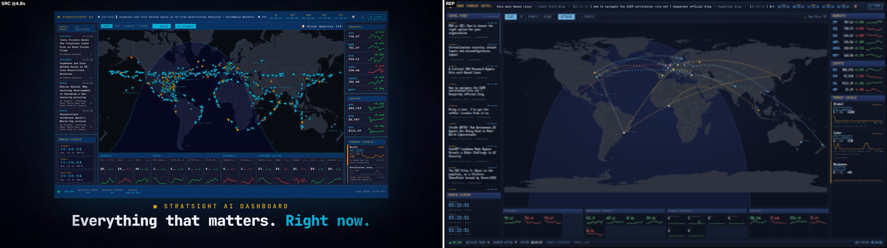

# Cyber Threats Intelligence — Command Desk

A single-screen, dark command-center dashboard for cyber threat intelligence.
The **layout is cloned from the "STRATSIGHT AI" reference** (demo video:
<https://youtu.be/Zl-vqITIeqU>) — header with news ticker and world clocks,
left intel feed, center live world map, right market/threat panels, bottom
stat strip, footer status bar — re-purposed for cyber threat intel.



## What it does

| Region | Content |
|---|---|
| Header | Brand, scrolling latest-headlines ticker, 5 zone clocks (UTC/LON/MOW/BEI/TYO), LIVE badge |
| Left | **ATTACKS** — Check Point-style per-second feed (CVE-style names, source ➜ target country, category ring badge) + **INTEL FEED** (live RSS aggregation, auto-rolls upward and loops seamlessly — hover to pause; chips filter by the 5 threat-news categories and show per-category health) + **SOURCES** (expanded per-source health panel: green/red dot, 24h article count, error tooltip; zone clocks live in the header) |
| Center | **LIVE CYBER THREAT MAP** headline with ticking `N ATTACKS ON THIS DAY` counter (pink), dot-matrix world map, draw-on category arcs (Malware = red, Phishing = purple, Exploit = gold), impact rings, event country labels, clickable category legend, **FLAT / 3D / HYBRID / GLOBE** views, ATTACKS toggle, +EVENTS burst, moon phase |
| Right | **TOP TARGETED COUNTRIES** (daily ranking with rate bars), **THREAT VECTORS** (real 24h corpus keyword counts: phishing / ransomware / ddos / malware / cve / apt, with sparklines), **THREAT LEVELS** (Global / Cyber / Business — computed from the live article corpus: 24h counts, delta, hourly sparkline, severity badge, latest headline) |
| Bottom | **5 threat-news category cards** — Traditional / Research / Gov & CERT / Endpoint / Threat Intel — each with a live health dot, active/total sources, 24h article count and the category's newest headline |
| Footer | ● ONLINE, ARTICLES TODAY, SOURCES ACTIVE, UPTIME, LAST FETCH |

## Data sources

44 live RSS feeds, curated from two hand-maintained indexes and merged into
the dashboard's **5 threat-news categories** (Traditional / Research /
Gov & CERT / Endpoint incl. mobile / Threat Intel):

- [NewBee119/threat-intelligence](https://github.com/NewBee119/threat-intelligence) —
  the vendor-news backbone (Kaspersky, Talos, Check Point, Microsoft, AWS, Unit 42, …)
- [zer0yu/CyberSecurityRSS](https://github.com/zer0yu/CyberSecurityRSS) —
  the research backbone (Project Zero, Tencent Xuanwu / Keen Lab, 先知社区, …)
  plus the Gov / CERT group (NCSC UK, CERT/CC, Huawei PSIRT)

Every entry is liveness-probed (HTTP 200 + XML body) before inclusion;
bot-walled, TLS-broken or retired feeds (CISA, VulDB, SentinelOne, AlienVault
Labs, Bugtraq, …) are excluded. Publishers that moved hosts are re-pointed at
their verified final URLs, and redirect hops may keep the same site under a
www/non-www variant of the source's own host — anything else off the
allowlist is rejected. Every entry is https-only with a unique hostname.

`GET /api/sources` exposes per-source health (`ok` / `count` / `error`) and a
per-group rollup (active / total / 24h articles) that drives the dashboard's
SOURCES panel and feed group chips.

## Check Point threat-map clone

The map layer and its widgets are cloned from
[threatmap.checkpoint.com](https://threatmap.checkpoint.com/) (captured
2026-11-06 with REA over CDP: reference frame in
`docs/evidence/CP_reference_threatmap.png`, replica in `CP_clone_flat.png` /
`CP_clone_globe.png`). Cloned elements: halftone dot-matrix continents,
draw-on arcs coloured by category (Malware / Phishing / Exploit), impact
rings, event country labels, the pink daily attack counter, the per-second
ATTACKS feed with CVE-style names, and the TOP TARGETED COUNTRIES ranking.
The legend chips filter arc categories on click, and the original
FLAT / 3D / HYBRID / GLOBE views still work on top.

**Honesty note:** the intel feed, threat levels and threat vectors are real
(derived from the aggregated RSS corpus). The threat-map counter, attack
feed, top-country ranking and market tickers are **deterministic simulations**
(seeded, reproducible) — the footer says
`MAP + ATTACKS: SIMULATED · FEEDS: LIVE`.

## Run (Docker)

```bash
docker compose up -d --build
# → http://127.0.0.1:8092   (loopback-only binding)
```

Health: `curl http://127.0.0.1:8092/api/healthz`

## Tests

```bash
docker run --rm -v "$PWD:/src:ro" -w /src -e PYTHONDONTWRITEBYTECODE=1 \
  python:3.12 sh -c "pip install -q -r requirements.txt -r requirements-dev.txt && \
                     python -m pytest tests/ -q -p no:cacheprovider"
```

35 tests: SSRF guard (scheme/host/DNS checks), feed parsing & classification
(English + Chinese keywords), source roster/group invariants, simulation
determinism, threat-map clone contracts, and API contracts — all run
inside a container.

## Security posture

- **SSRF guard** on every outbound fetch: http/https only, domain allowlist
  (the curated source list), DNS resolution checked against loopback / private /
  link-local / reserved addresses, manual redirect validation, 2 MB byte cap.
- Container runs as **non-root** (uid 10001), `no-new-privileges`, host port
  bound to **127.0.0.1** only.
- No secrets in code; no runtime CDN dependencies — d3, topojson-client,
  Natural Earth 110m TopoJSON and JetBrains Mono are vendored in
  `app/static/vendor/` (pinned versions, ISC/OFL-licensed).

## API

`/api/news` · `/api/threats` · `/api/markets` · `/api/map-events` ·
`/api/threatmap` · `/api/status` · `/api/healthz` — plain JSON, no auth
(loopback demo).

## Layout parity evidence

`docs/evidence/verify.jsonl` is the verification ledger; composites live in
`docs/evidence/` (SRC = reference frame @4.8s/18.6s, REP = live dashboard
screenshot at 1920×1080).
